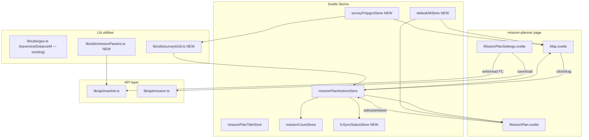

# Design Document: Mission Planning Enhancements

## Overview

This document describes the technical design for the Mission Planning Enhancements feature of Sidak GCS. The feature closes the gap between the current `MissionPlan.svelte` / `Map.svelte` implementation and the full mission planning capabilities described in the requirements. Ten capability areas are addressed: map-click waypoint placement, FC mission upload/download, home position management, altitude reference mode, auto-grid survey generation, global default altitude, waypoint distance measurement, mission size validation, mission reset/rewind controls, and visual distinction for spline waypoints.

The implementation extends existing components and stores rather than replacing them, preserving the established SvelteKit + Leaflet + MAVLink architecture.

---

## Architecture

The mission planner page (`/mission-planner`) is a 12-column CSS grid that places `Map.svelte` (10 cols, 4 rows), `MissionPlan.svelte` (10 cols, 2 rows), and `MissionPlanSettings.svelte` (2 cols, 4 rows) side by side. The enhancements touch all three surfaces:



**Key architectural decisions:**

1. **Map-click integration:** The existing `leafletMap.on('click', ...)` handler in `Map.svelte` already adds waypoints when `Object.keys(actions).length > 1`. It is extended to apply `Default_Alt`, enforce the 99-waypoint per-click guard, and emit the no-home-position warning. No new event bus is introduced.

2. **FC sync status:** A new `fcSyncStatusStore` (`'Synced' | 'GCS_Ahead' | 'FC_Ahead'`) lives in `missionPlanStore.ts`. It is set to `GCS_Ahead` in a `$: missionPlanActionsStore.subscribe(...)` side-effect and toggled to `Synced` by the write/read FC operations in `MissionPlanSettings.svelte`. The status badge is rendered inside `MissionPlan.svelte`'s toolbar.

3. **`frame` field:** `MissionPlanItem` gains an optional `frame: number | null` field. All new waypoints default to `frame = 3` (MAV_FRAME_GLOBAL_RELATIVE_ALT). Existing missions that lack the field are treated as `frame = 3` at read time.

4. **Auto-grid polygon drawing:** A boolean prop `surveyMode` is added to `Map.svelte`. When `true`, Leaflet click events accumulate into a temporary polygon array rather than adding waypoints to the store. The Survey Grid button in `MissionPlanSettings.svelte` toggles this mode. A dedicated `SurveyGridPanel.svelte` component provides the parameter inputs (spacing, angle, entry direction) and the confirm/cancel actions.

5. **Default altitude:** A new `defaultAltStore` (writable, initialised from `localStorage`) is imported by both `Map.svelte` and `MissionPlan.svelte`. A `DefaultAltInput` subcomponent (or inline in the `MissionPlan.svelte` toolbar) renders the numeric input with validation.

6. **Distance calculation:** `haversineDistanceM` already exists in `src/lib/utils/geo.ts`. Segment distances are computed reactively from `missionPlanActionsStore` in `MissionPlan.svelte` and rendered inline. The total distance is also kept reactive.

7. **Waypoint counter:** `missionCountStore` already tracks count. The counter badge `${count} / 650 waypoints` is added to the `MissionPlan.svelte` toolbar. The yellow warning threshold (≥ 586) uses a derived reactive variable.

8. **MIS_RESTART / MIS_OPTIONS toggles:** Added as two toggle rows at the bottom of `MissionPlanSettings.svelte`. Both call `writeParam` from `lib/api/mavlink.ts` and read their initial state from `mavlinkParamStore`.

9. **Spline polyline rendering:** `addPolyline` in `Map.svelte` is extended to accept an optional `dashed: boolean` and `color: string` argument. When constructing polylines between a NAV_SPLINE_WAYPOINT and its neighbours, the dashed orange style is applied.

---

## Components and Interfaces

### Modified: `missionPlanStore.ts`

```typescript
export interface MissionPlanItem {
  type: string;
  lat: number;
  lon: number;
  alt: number | null;
  notes: string;
  param1: number | null;
  param2: number | null;
  param3: number | null;
  param4: number | null;
  /** MAVLink coordinate frame. null treated as 3 (RELATIVE) for backward compat. */
  frame?: number | null;
  [key: string]: unknown;
}

// New stores added to the file:
export type FcSyncStatus = 'Synced' | 'GCS_Ahead' | 'FC_Ahead';
export const fcSyncStatusStore = writable<FcSyncStatus>('GCS_Ahead');

/** Global default altitude in metres, range 1–500. */
export const defaultAltStore = writable<number>(50);
```

### New: `src/lib/utils/surveyGrid.ts`

```typescript
export interface SurveyGridParams {
  polygon: { lat: number; lng: number }[];   // ≥3 vertices
  spacingM: number;      // 1–500
  angleRad: number;      // flight angle in radians
  entryVertex: 'first' | 'last';
}

export interface SurveyGridResult {
  waypoints: { lat: number; lng: number }[];
  lineCount: number;
}

/**
 * Generates a boustrophedon (lawnmower) grid of waypoints covering the polygon.
 * Pure function — no side effects.
 */
export function generateSurveyGrid(params: SurveyGridParams): SurveyGridResult;
```

**Algorithm sketch:**
1. Rotate the polygon's bounding box to align with `angleRad`.
2. Sweep parallel lines at `spacingM` intervals across the rotated bounding box, clipping each line to the polygon boundary.
3. Alternate sweep direction (boustrophedon) and append turn waypoints at each line end.
4. Rotate the resulting waypoints back to geographic coordinates.

### New: `src/lib/utils/missionParams.ts`

```typescript
/**
 * Sets or clears bit 0 of a bitmask, preserving all other bits.
 */
export function setBit0(currentValue: number, enable: boolean): number;

/**
 * Reads bit 0 from a bitmask.
 */
export function getBit0(value: number): boolean;
```

### New: `src/components/SurveyGridPanel.svelte`

Renders as a floating panel overlaid on `Map.svelte` when `surveyMode` is active. Exports:

```typescript
export let onConfirm: (params: SurveyGridParams) => void;
export let onCancel: () => void;
// Inputs: spacingM (number), angleDeg (number), entryVertex ('first'|'last')
```

### Modified: `Map.svelte`

New props and state:

```typescript
export let surveyMode: boolean = false;    // toggles polygon-drawing mode
let polygonVertices: L.LatLng[] = [];      // accumulates during polygon draw
let polygonPreviewLayer: L.Polygon | null; // dashed preview polygon
let gridPreviewLayer: L.LayerGroup | null; // survey grid preview polylines
let dragTooltip: L.Tooltip | null;         // lat/lng tooltip during drag
```

Extended `addPolyline` signature:

```typescript
function addPolyline(
  start: L.LatLng,
  end: L.LatLng,
  opts?: { dashed?: boolean; color?: string }
): void
```

Home marker (index 0) uses a separate Leaflet `DivIcon` with a house SVG instead of the standard waypoint icon.

### Modified: `MissionPlan.svelte`

New toolbar elements:
- Default Alt input (debounced, validated, synced with `defaultAltStore` and `localStorage`)
- Waypoint counter badge: `${count} / 650 waypoints` with yellow highlight when `count >= 586`
- FC Sync Status badge: coloured dot + label (`Synced` / `GCS_Ahead` / `FC_Ahead`)
- Total mission distance display

### Modified: `MissionPlanSettings.svelte`

New buttons/controls:
- **Write to FC** — triggers `writeMissionToFC()`
- **Read from FC** — triggers `readMissionFromFC()`
- **Survey Grid** — toggles `surveyMode` on `Map.svelte` via a shared store or prop
- **Mission Restart** toggle — reads/writes `MIS_RESTART`
- **Continue after Disarm** toggle — reads/writes bit 0 of `MIS_OPTIONS`

---

## Data Models

### Updated `MissionPlanItem`

| Field | Type | Notes |
|---|---|---|
| `type` | `string` | MAVLink command name |
| `lat` | `number` | Decimal degrees |
| `lon` | `number` | Decimal degrees |
| `alt` | `number \| null` | Metres |
| `frame` | `number \| null` | MAVLink frame int; `null` → treated as 3 |
| `notes` | `string` | GCS-only, not uploaded |
| `param1–4` | `number \| null` | MAVLink params |

### MAVLink Frame Mapping

| UI Label | `frame` value | MAVLink constant |
|---|---|---|
| `RELATIVE` | `3` | `MAV_FRAME_GLOBAL_RELATIVE_ALT` |
| `ABSOLUTE` | `0` | `MAV_FRAME_GLOBAL` |
| `TERRAIN` | `10` | `MAV_FRAME_GLOBAL_TERRAIN_ALT` |

### FC Sync Status State Machine

```
Initial: GCS_Ahead
                                     ┌──────────────────────────────────────────┐
                                     │  any edit/add/remove in missionPlanActions │
                          ┌──────────▼──────────────┐                            │
  Write FC success ──────►│       Synced            │◄──── Read FC success       │
                          └──────────┬──────────────┘                            │
                                     │  any edit/add/remove                      │
                                     └──────────────────────────────────────────►│ GCS_Ahead
```

`FC_Ahead` is set after a successful Read from FC (the FC had a mission the GCS did not).

### Default Altitude Storage

- `localStorage` key: `missionDefaultAlt`
- Valid range: `[1, 500]` metres
- On-load behaviour: restore if valid, else use 50 m and show inline validation message

### Survey Grid Parameters

| Field | Range | Default |
|---|---|---|
| `spacingM` | 1–500 m | 50 m |
| `angleDeg` | 0–359° | 0° |
| `entryVertex` | `'first' \| 'last'` | `'first'` |

### Waypoint Limit Constants

```typescript
export const FC_WAYPOINT_LIMIT = 650;
export const FC_WAYPOINT_WARNING_THRESHOLD = 586;
```

---

## Correctness Properties

*A property is a characteristic or behavior that should hold true across all valid executions of a system — essentially, a formal statement about what the system should do. Properties serve as the bridge between human-readable specifications and machine-verifiable correctness guarantees.*

### Property 1: Map-click waypoint stores correct coordinates

*For any* valid latitude/longitude pair clicked on the map and any `Default_Alt` value in [1, 500], when a Home_Position exists (index 0 is present), the resulting `missionPlanActionsStore` should contain a new entry whose `lat` equals the click latitude, `lon` equals the click longitude, and `alt` equals `Default_Alt`.

**Validates: Requirements 1.1, 1.2**

---

### Property 2: Drag updates store coordinates

*For any* waypoint index and any valid new (lat, lng) position dragged to, the `missionPlanActionsStore` entry at that index should have `lat` and `lon` exactly equal to the drag-end coordinates.

**Validates: Requirements 1.3**

---

### Property 3: Successful FC upload notification contains waypoint count

*For any* mission plan containing N > 0 waypoints, when the Write to FC operation completes successfully, the displayed success notification text should contain the number N.

**Validates: Requirements 2.2**

---

### Property 4: Failed FC upload preserves local store

*For any* mission plan state, when the Write to FC operation fails (timeout or error response), the contents of `missionPlanActionsStore` should be byte-for-byte identical to the state before the write was initiated.

**Validates: Requirements 2.3**

---

### Property 5: Edit after sync transitions to GCS_Ahead

*For any* `fcSyncStatusStore` state of `Synced`, performing any edit, addition, or removal on `missionPlanActionsStore` should transition `fcSyncStatusStore` to `GCS_Ahead`.

**Validates: Requirements 2.7**

---

### Property 6: Successful FC operation sets status to Synced

*For any* prior sync status, when a Write to FC or Read from FC operation completes successfully, `fcSyncStatusStore` should be `Synced`.

**Validates: Requirements 2.8, 2.9**

---

### Property 7: Set Home copies mavLocation exactly

*For any* valid `{ lat, lng }` value held in `mavLocationStore`, activating "Set Home to Current Location" should write exactly those values to `missionPlanActionsStore` index 0's `lat` and `lon` fields.

**Validates: Requirements 3.3**

---

### Property 8: Home field edits are reflected in the store

*For any* numeric value entered in the Home_Position lat, lon, or alt input fields, `missionPlanActionsStore[0]` should contain the new value in the corresponding field.

**Validates: Requirements 3.5**

---

### Property 9: Altitude frame selector maps to correct MAVLink integer

*For any* altitude reference mode selected (`RELATIVE`, `ABSOLUTE`, `TERRAIN`), the `frame` field stored in `missionPlanActionsStore` for that waypoint should equal exactly `3`, `0`, or `10` respectively.

**Validates: Requirements 4.1, 4.2**

---

### Property 10: New waypoints default to RELATIVE frame

*For any* method of waypoint creation (map click or "Add Action" button), the `frame` field on the newly created `MissionPlanItem` should equal `3` (`MAV_FRAME_GLOBAL_RELATIVE_ALT`).

**Validates: Requirements 4.3**

---

### Property 11: Survey grid waypoints lie within the survey polygon

*For any* valid convex or concave polygon with ≥ 3 non-collinear vertices and any line spacing in [1, 500] metres, every waypoint produced by `generateSurveyGrid` should lie within or on the boundary of the input polygon (within floating-point tolerance).

**Validates: Requirements 5.2**

---

### Property 12: Default alt is persisted and restored

*For any* value `v` in [1, 500], after the operator sets `Default_Alt` to `v`, `localStorage['missionDefaultAlt']` should equal `v`, and on the next initialisation, the `defaultAltStore` should be restored to `v`.

**Validates: Requirements 6.2, 6.4**

---

### Property 13: New waypoints use current default altitude

*For any* `Default_Alt` value `v` in [1, 500], any waypoint created via map click or "Add Action" should have `alt == v`.

**Validates: Requirements 6.2, 6.3**

---

### Property 14: Invalid stored default altitude resolves to 50 m

*For any* value stored in `localStorage['missionDefaultAlt']` that is non-numeric, below 1, or above 500, the `defaultAltStore` on initialisation should be `50`.

**Validates: Requirements 6.4**

---

### Property 15: Segment distance matches Haversine formula

*For any* consecutive pair of waypoints with valid coordinates, the segment distance displayed in the waypoint list should equal `Math.round(haversineDistanceM(lat1, lon1, lat2, lon2))`.

**Validates: Requirements 7.1**

---

### Property 16: Total distance equals sum of segment distances

*For any* mission plan with N ≥ 2 waypoints, the total mission distance displayed in the toolbar should equal the sum of all (N − 1) individual segment distances.

**Validates: Requirements 7.4**

---

### Property 17: Out-of-range coordinates produce unavailable distance

*For any* waypoint whose `lat` is outside [−90, 90] or `lon` is outside [−180, 180], the distance for all segments connected to that waypoint should be marked as unavailable rather than a numeric value.

**Validates: Requirements 7.6**

---

### Property 18: Waypoint counter format is always correct

*For any* waypoint count N in [0, 650], the counter displayed in the toolbar should be the string `"${N} / 650 waypoints"`.

**Validates: Requirements 8.1**

---

### Property 19: Store count never exceeds 650

*For any* number of addition attempts when `missionCountStore` is already at 650, the `missionPlanActionsStore` should remain at 650 entries and no new entry should be appended.

**Validates: Requirements 8.3**

---

### Property 20: MIS_OPTIONS bit 0 manipulation preserves other bits

*For any* current `MIS_OPTIONS` parameter value `v` and desired "Continue after Disarm" state `b` (true or false), the value passed to `writeParam('MIS_OPTIONS', ...)` should have bit 0 equal to `b ? 1 : 0` and all other bits identical to those in `v`.

**Validates: Requirements 9.4**

---

### Property 21: Failed FC parameter write reverts toggle state

*For any* initial toggle state `s` (on or off) for either `MIS_RESTART` or `MIS_OPTIONS`, when the FC write fails or the FC is not connected, the toggle displayed in the UI should revert to `s`.

**Validates: Requirements 9.6, 9.7**

---

## Error Handling

| Scenario | Handling |
|---|---|
| Map click with no Home_Position | `showNotification` warning, auto-dismiss 5 s; waypoint not added |
| Map click when count == 99 | `showNotification` error; waypoint not added |
| Write to FC — timeout (> 30 s) | `showNotification` error with timeout reason; local store unchanged |
| Write to FC — API error | `showNotification` error with message; local store unchanged |
| Write to FC — count > 650 | Upload cancelled before transmission; `showNotification` error with count and limit |
| Read from FC — timeout / error / zero count | `showNotification` error; local store preserved |
| Set Home — no GPS fix | `showNotification` error; Home_Position unchanged |
| TERRAIN frame selected | `showNotification` warning about FC terrain data requirement |
| Default_Alt out of range on blur | Reset to nearest boundary value; inline validation message shown |
| Default_Alt invalid in localStorage on init | Restore to 50 m; inline validation message shown; cleared on next valid edit |
| Survey polygon < 3 vertices or zero area | `showNotification` error; return to polygon-drawing mode |
| Survey grid > 650 waypoints | Show confirmation dialog; proceed only on explicit confirm |
| MIS_RESTART / MIS_OPTIONS write fail | `showNotification` error; revert toggle to pre-change state |
| FC disconnected when toggles changed | `showNotification` error; revert toggle |
| frame store write failure | Revert selector to previous value; `showNotification` error |

---

## Testing Strategy

### Unit tests (`src/lib/utils/*.test.ts`)

Unit tests cover specific examples and edge cases for pure functions:

- `geo.ts` — `haversineDistanceM`: known coordinate pairs, antipodal points, zero distance (same point)
- `surveyGrid.ts` — `generateSurveyGrid`:
  - Triangle polygon with known coverage produces non-empty waypoints
  - spacing = 1 m produces more waypoints than spacing = 100 m for the same polygon
  - spacing > polygon width produces exactly two waypoints (entry + exit)
  - Grid > 650 waypoints is detected correctly
- `missionParams.ts` — `setBit0` / `getBit0`:
  - `setBit0(0b1010, true)` → `0b1011`
  - `setBit0(0b1011, false)` → `0b1010`
  - `getBit0(0b1001)` → `true`
  - `getBit0(0b1000)` → `false`

### Property-based tests (`src/lib/utils/*.test.ts`)

PBT library: **[fast-check](https://fast-check.dev/)** (no new install needed — add as devDependency: `fast-check@^3`).
Minimum 100 iterations per property. Each test is tagged with the property it validates.

```typescript
// Tag format: Feature: mission-planning-enhancements, Property N: <text>
```

Properties to implement as PBT (see Correctness Properties section for full statements):

| Test file | Properties |
|---|---|
| `surveyGrid.test.ts` | P11 — grid waypoints inside polygon |
| `missionPlanLogic.test.ts` | P1, P2, P3, P4, P5, P6, P7, P8, P9, P10 |
| `geo.test.ts` (extend existing) | P15, P16, P17 |
| `missionValidation.test.ts` | P13, P14, P18, P19 |
| `missionParams.test.ts` | P20, P21 |
| `defaultAlt.test.ts` | P12 |

**P9 example (frame mapping):**
```typescript
// Feature: mission-planning-enhancements, Property 9: altitude frame maps to correct MAVLink int
it.each([
  ['RELATIVE', 3],
  ['ABSOLUTE', 0],
  ['TERRAIN', 10],
])('frame selector %s stores %i', (mode, expected) => {
  expect(frameToMavlink(mode)).toBe(expected);
});
```

**P20 example (bit manipulation):**
```typescript
// Feature: mission-planning-enhancements, Property 20: bit 0 manipulation preserves other bits
fc.assert(fc.property(
  fc.integer({ min: 0, max: 0xFFFF }),
  fc.boolean(),
  (v, b) => {
    const result = setBit0(v, b);
    expect(result & 1).toBe(b ? 1 : 0);
    expect(result & ~1).toBe(v & ~1);
  }
), { numRuns: 100 });
```

### Integration tests

- Write to FC: mock `loadMission()` to succeed; verify `fcSyncStatusStore` becomes `Synced`
- Write to FC — failure: mock `loadMission()` to throw; verify store unchanged, error notification shown
- Read from FC: mock a MAVLink mission download response; verify store is populated
- MIS_RESTART toggle: mock `writeParam`; verify called with `('MIS_RESTART', 0 or 1, type)`
- MIS_OPTIONS toggle: mock `writeParam`; verify bit 0 is toggled and other bits preserved

### Vitest

Run tests with:
```
npx vitest --run
```
